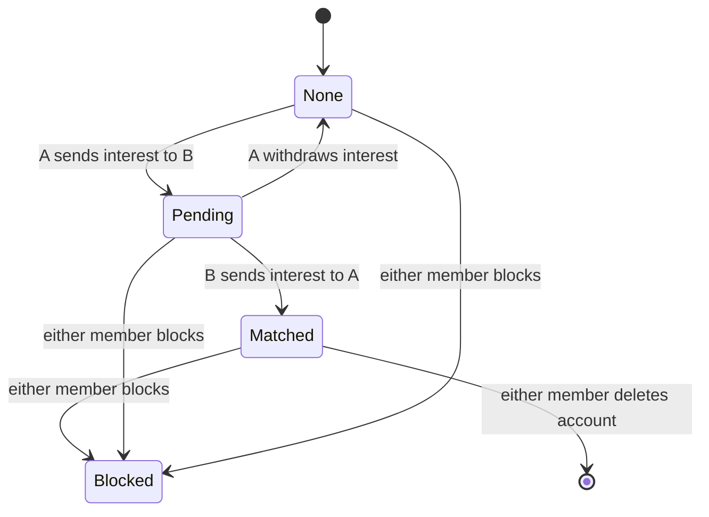

# 01 cellmate core: accounts, profiles, browse, matched messaging, reports

## Problem

People with criminal convictions face stigma on mainstream social and dating sites, where a conviction is often grounds for rejection or removal.
They have no site where a conviction history is expected and can be shared openly.
cellmate.social gives them a place to find friends and partners who share that experience.

## What it is

A Go web app at cellmate.social where adults with convictions sign up, build a profile, browse other members, and message each other once both sides opt in.
Backing data: none. Requirements come from the workflow input and README.md.

Messaging opens only on a mutual opt-in:

## User stories

- As a new member, I sign up with my email and a password so that I have my own account.
- As a member, I write a profile with a name, photo, bio, and my conviction history if I choose so that others know who I am.
- As a member, I browse and search profiles so that I find people I want to talk to.
- As a member, I send interest to someone and can message them once they send interest back so that I only get messages from people I chose.
- As a member, I block or report someone so that I stop hearing from them and an admin reviews the report.
- As an admin, I see open reports and act on them so that members who break the rules are removed.

## Requirements

- **Accounts**
  - A visitor signs up with an email and a password and gets a logged-in session.
  - Sign up fails with a clear message when the email is already registered.
  - Passwords are stored as a slow salted hash and never in plain text.
  - A member logs in with email and password and logs out, which ends the session.
  - A wrong email or password shows one generic error that does not say which part was wrong.
  - A member deletes their account, which removes their profile, interests, and messages from other members' view.
- **Profiles**
  - A profile has a display name, one photo, a bio, and an optional conviction history field.
  - Display name is required. Photo, bio, and conviction history are optional.
  - Only the profile owner can edit their profile.
  - The photo upload accepts JPEG and PNG only and rejects files over a set size limit.
- **Browse and search**
  - A logged-in member sees a paged list of other members' profiles.
  - A member searches profiles by text in the display name or bio.
  - Profiles of members who blocked the viewer, or whom the viewer blocked, never appear.
  - Logged-out visitors cannot see any profile.
- **Matched messaging**
  - A member sends interest to another member, and the pair becomes Matched when both have sent interest.
  - A member withdraws interest while the pair is still Pending.
  - Only a Matched pair can send each other text messages.
  - A member sees their matches and the message thread with each match.
  - A message sent to a non-matched or blocked member is rejected by the server, not only hidden in the UI.
- **Block and report**
  - A member blocks another member, which ends any match and stops all interest and messages in both directions.
  - A member reports another member with a reason picked from a fixed list plus optional text.
  - An admin sees open reports with the reporter, the reported member, the reason, and the text.
  - An admin closes a report with no action or suspends the reported account.
  - A suspended account cannot log in, and its profile does not appear in browse or search.

## Not in scope

- Feeds and posts.
- Groups.
- Payments and paid tiers.
- Native mobile apps.
- Identity checks and conviction record checks.

## Open questions

- Is conviction history self-reported only, or checked against public records?
- What is the minimum age, and which legal limits apply, such as parole or probation terms that bar contact or internet use?
- Must the display name be a real name, or can it be a pseudonym?

## Done when

- Two test accounts sign up, write profiles, find each other by search, send interest both ways, and exchange messages.
- A third account that did not match either of them cannot message them, and the server rejects the attempt.
- A block from one matched member ends the match, and neither member sees the other in browse.
- A report filed by one member shows up in the admin view, and suspending the reported account stops it from logging in.
- `go test ./...`, `go vet ./...`, and `gofmt -l .` pass with the tests that cover each requirement above.
